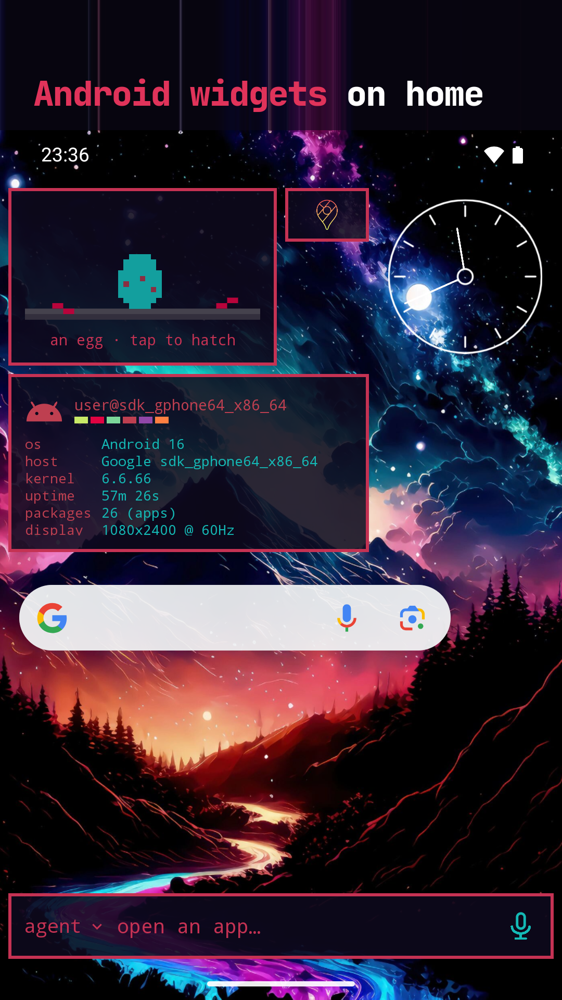
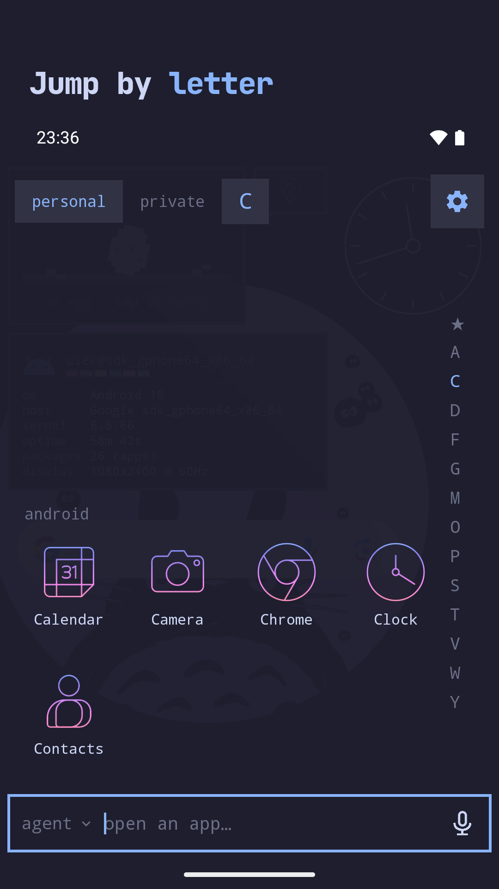
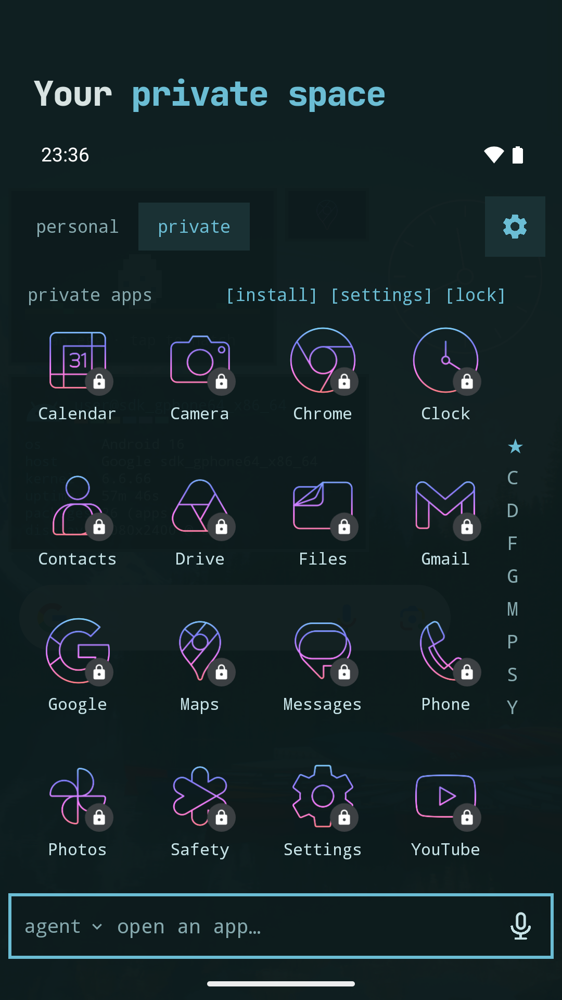
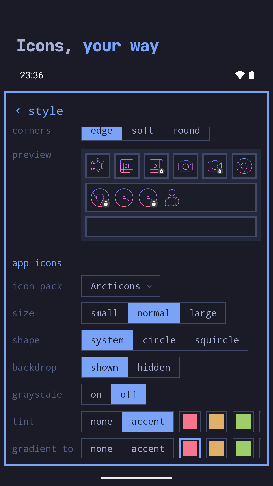
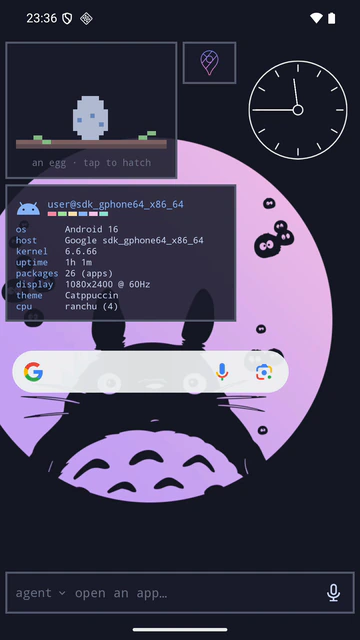

# OmaLauncher++

An Android home screen with the look of [Omarchy](https://omarchy.org), and an
optional Arch Linux ARM system next to your phone apps. OmaLauncher++ runs the
system under proot, without root, and is its Wayland compositor: every Linux
window opens as its own Android task, with its own card in Recents.

OmaLauncher++ is an independent fork of
[Omalauncher](https://github.com/SimonSchubert/omalauncher) by Simon Schubert,
with the features [below](#what-omalauncher-adds) on top. It's its own app
(`dev.omalauncher.pp`), so it installs next to Omalauncher rather than over it.
Download the APK from the
[releases](https://github.com/johannSo/omalauncher.pp/releases).


<p>
  
  
  
  
  
  
  
  
</p>

- **Themes**: all 22 Omarchy themes, with their wallpapers, applied to the
  launcher and to the Linux apps, plus the community themes from
  [omarchy.org/themes](https://omarchy.org/themes/), or your own in
  `~/.config/omarchy/themes`
- **Widgets** written in OWL, a small declarative language you can edit on the
  phone, plus a [widget store](https://github.com/SimonSchubert/omarchy-widgets)
- **Linux, optional**: pacman and the AUR, Linux apps in their own windows,
  terminal widgets, a file manager, and opt-in GPU acceleration on Mali and Adreno 6xx+ GPUs
- **Coding agents**: the bar at the bottom sends a prompt to Claude Code, Codex,
  Copilot, opencode and others, which open in a terminal
- No account, no ads, no tracking

Needs an arm64 phone with Android 10 or newer. Without Linux, the launcher still
has the themes, wallpapers, Android apps and the widgets that don't run commands.

## What OmaLauncher++ adds

- **Android widgets on home**: home's long-press menu › android widgets lists
  every widget your apps offer, with a preview and the cells it takes, and an
  app's long-press menu offers its own. They move, resize and swap like any
  tile, and `layout.toml` writes them as `{ android = "pkg/provider", id = n }`
- **Private space** (Android 15+): the drawer lists it on a private tab with a
  lock on its icons, and can lock it, unlock it and install apps into it. While
  it's locked, none of its apps show, in search either, and it can hide
  entirely. Private apps never go on home and aren't counted as recent
- **Drawer tabs by swipe**: swipe sideways to move between the personal, work
  and private tabs
- **Letter rail** in the drawer, Niagara-style: touch or drag along it to show
  only the apps under that letter
- **App icons without limits** (style › app icons, `[icons]` in `style.toml`):
  icon packs made for Nova, ADW, Apex, GO and the like, plus size, circle or
  squircle shape, the logo without its backdrop, grayscale, a tint from the
  theme or a gradient, and labels on or off for home and the drawer
- **Swipe down** can pull down Android's notification shade (settings ›
  gestures › swipe down)
- **Shut down Linux** in settings › linux: it ends every guest process and the
  foreground service, keeps files and packages, and stays off after a restart
  until you start it again
- **Mali on the Pixel 6 and 6a**: the pinned PanVK-kbase is RC3, which knows
  the Mali-G78
- **The bar searches everything**: besides apps, it does sums and unit
  conversions ("15% of 80", "5 km in mi"; Enter copies), and finds Android's
  settings pages, apps' shortcuts, contacts (opt-in), files in Linux's home,
  pacman and AUR packages ("install btop") and the web. An app the text names
  still opens on Enter; settings › search, or `[search]` in `style.toml`,
  turns each kind on or off
- **Hidden and renamed apps**: hide any app from the drawer, recent apps and
  search, or give it another name everywhere, from its long-press menu or
  settings › hidden apps. Typing a hidden app's full name still finds it unless
  you turn that off. Both live in `~/.config/omalauncher/apps/apps.toml`
- **More gestures**: double tap, two-finger swipes up and down, and pinches in
  and out, besides swiping up and down. Each opens the drawer, a panel, the
  shade or quick settings, locks the screen, shows recent apps, launches an
  Android or Linux app, runs a command or asks your agent (settings › gestures,
  or `double-tap = "lock"` in `style.toml`). Locking and recents use an opt-in
  accessibility service that reads nothing on screen
- **Focus mode and app timers** (settings › focus): profiles like "work" hide
  the apps they leave out from the drawer, search, recent apps and home, can
  turn on Do Not Disturb, and switch on by schedule or by typing
  `focus work 25m` in the bar. An app timer gives an app a daily limit, after
  which it opens to a "time's up" screen. Widgets get today's screen time
- **Quick settings tiles**: Linux (running or off, a tap starts or shuts it
  down), Terminal and Ask agent, added from settings › quick settings tiles
- **Tiling desktop**: plug the phone into a monitor and Linux windows open side
  by side on it in Hyprland's dwindle layout, with Omarchy's gaps, borders and
  a bar, while the phone keeps working. Super+1–9, Super+arrows, Super+F and
  Super+V work as in Hyprland, and unplugging gives every window its own task
  again. On tablets and foldables, `desktop.large-screens` opens windows in
  the desktop on the device's own screen
- **Linux notifications**: `notify-send`, GTK apps and build tools post Android
  notifications with their app's name and icon, formatted text, images and
  buttons; a tap brings the app's window back. The launcher runs the guest's
  D-Bus session bus for this
- **Snapshots of Linux** (settings › linux › snapshots): one is taken before
  every system update, and restoring it rolls back an update that broke
  something. Snapshots share unchanged files, and a restore swaps the whole
  system at once, keeping /root and /home unless you roll them back too
- **SSH into Linux** (settings › linux › ssh): an OpenSSH server on port 8022,
  keys only by default, with the `ssh` command and a QR code for each of the
  phone's addresses. The same page lists the servers Linux listens on, to open
  in the phone's browser or share on the LAN
- **Coding agent status**: Claude Code and Codex sessions each get a
  notification showing whether they're working, waiting for you or asking
  permission; Allow and Deny answer from the notification, and a tap opens the
  session's terminal
- **Scheduled agent jobs** (settings › agents › jobs, or
  `~/.config/omalauncher/jobs/jobs.toml`): a prompt, an agent and a schedule
  (`daily at 07:00`, `weekdays at 9`, a cron line). Jobs run headless on time
  through Doze, Linux starts for them, and their output shows in the jobs
  screen, a notification and the jobs widget
- **MCP server**: `omalauncher-mcp` lets coding agents change home, widgets,
  the theme and the style through tools that check each change first, list
  and open apps, and preview widgets. It's added to Claude Code, Codex,
  OpenCode, Copilot, Crush and Cursor's configs by itself
- **Widgets that talk to other apps**: `intent(...)` and `broadcast(...)` reach
  Tasker, Home Assistant or KDE Connect, a `broadcast("…")` source hears them,
  and with settings › values from other apps on, they can set values a widget
  reads from `source ext = external`
- **Location, steps and seeking for widgets**: `android.location` (rough, with
  the place's name) and `android.steps`, each asked for from a tap on a widget
  that says why, and `media("seek", seconds)`. The today tile can show the
  weather where you are

The icon options, the letter rail and swipe-down come from
[Omalauncher+](https://github.com/adrianratajczak/Omalauncher-Plus) by
adrianratajczak, rebuilt on `style.toml` and `drawer.owl`.

Here a drag along the rail narrows the drawer letter by letter, a swipe moves
to the private tab, and the private space locks and unlocks:



## Coming from Omalauncher

Settings › backup › export to a file in the old launcher (an Omalauncher fork
build from v0.16.0-tos.2 on), then import from a file in OmaLauncher++: home,
the style, your widgets, faces, owl apps and themes come over. Android widgets
come back as tiles to tap and add again, widgets' secrets have to be entered
again, and Linux isn't in a backup, so OmaLauncher++ sets it up again.

## Using it

The bar: the one input at the bottom of the home screen opens apps and asks
coding agents. Focusing it opens the list of Linux and Android apps; typing
narrows the list, and Enter opens the highlighted app or sends the text to the
agent. Short queries that name an app open it, sentences go to the agent; Tab
and the arrow keys move the highlight. Tap the agent's name to pick another
installed one; the choice is saved in `~/.config/omalauncher/agent`. Hold the mic to talk and release to send, or tap it to dictate
into the field. Speech is recognized by Android (on the device when the phone
supports it), so only text reaches Linux.

The app drawer is a widget too, `drawer.owl` in the widgets folder, so an
agent can rewrite it.

Touch input in Linux windows: tap is a left click, long press is a right
click, drag scrolls; apps with touch support (foot, GTK) get real touch.
Hardware keyboard shortcuts: Super+D (the drawer), Super+T (terminal),
Super+Down (the swipe-down panel), Super+1..9 (home pages) on the home screen;
Super+W (close) in Linux windows. Android keeps Super on its own, Super+Space,
Super+A and Super+Enter for itself, so Omarchy's Super+Space and Super+Enter
can't be used.
Super+Esc leaves a Linux window or a terminal tile without closing it, since
Esc itself is theirs; a gamepad's B (Back) does too, as its buttons stay the
launcher's. On home, in the app drawer, panels and
widgets, the arrows or Tab (a gamepad's D-pad) move between tiles and what
takes taps, past the first or last tile to the next page; Enter (A) opens it
and Menu or holding Enter long-presses it, which selects a home tile for
editing. Right goes into a widget's own buttons, Left back out to its tile.
Up from the bar goes back to the tiles, or into the open drawer.
Enter on a terminal tile goes into it, and Enter there types into it, or
restarts it once it has exited. Esc (B) closes the drawer, a panel or a
widget's screen, like Back. Long text, like a license or a file being
shared, takes the arrows until it has all been shown, Page Up and Page Down a
screenful. On the pages screen, Enter picks a page up by its ≡ and the arrows
move it, until Enter or Esc puts it down. Menu on a notification in the
swipe-down panel dismisses it.

## Building

```sh
./scripts/fetch-proot.sh          # Termux's proot -> app/src/main/jniLibs (needs bsdtar)
./gradlew :app:installDebug
# optional: skip the 830 MB download on the device
adb push ArchLinuxARM-aarch64-latest.tar.gz /sdcard/Android/data/dev.omalauncher.pp/files/
```

Tests: `./gradlew :owl:test :app:testDebugUnitTest`. `./gradlew :owl:owlJar`
builds `owl/build/cli/owl.jar`, the checker the widget store's CI runs.

In debug builds you can launch guest commands with
`adb shell am start -n dev.omalauncher.pp/.MainActivity --es exec foot`.

- [docs/ARCHITECTURE.md](docs/ARCHITECTURE.md): the compositor, rendering, GPU
  acceleration, and how updates reach existing installs
- [docs/RELEASING.md](docs/RELEASING.md): OmaLauncher++ releases, and Omalauncher's
  Play releases and store assets
- [app/src/main/assets/widgets/README.md](app/src/main/assets/widgets/README.md):
  the widget language

## Layout

- `app/`: the Android app (Kotlin, Jetpack Compose, and the JNI bridge in `src/main/cpp`)
- `owl/`: the widget language and the `owl` command line, plain Kotlin
- `art/`: SVG masters for the app, agent and store icons
- `store/`: Play listing sources (screenshot frames, privacy policy)
- `fastlane/`: the Play listing and the upload lanes
- `scripts/`: fetching proot and theme colors, rendering icons, screenshots and widget previews

## License

MIT, see [LICENSE](LICENSE), for the code and artwork of Omalauncher and
OmaLauncher++. The
coding agents' logos, the symbol font and Omarchy's theme colors are not
covered; [THIRD_PARTY.md](THIRD_PARTY.md) lists them with their sources and
licenses. The app also ships proot, talloc and libandroid-shmem (GPL-2.0,
LGPL-3.0 and BSD-3-Clause, prebuilt by Termux), listed in the app under
settings › licenses.

OmaLauncher++ is an independent fork, not affiliated with or endorsed by Simon
Schubert's Omalauncher, Omarchy, Arch Linux, or the makers of the coding agents
it installs.
